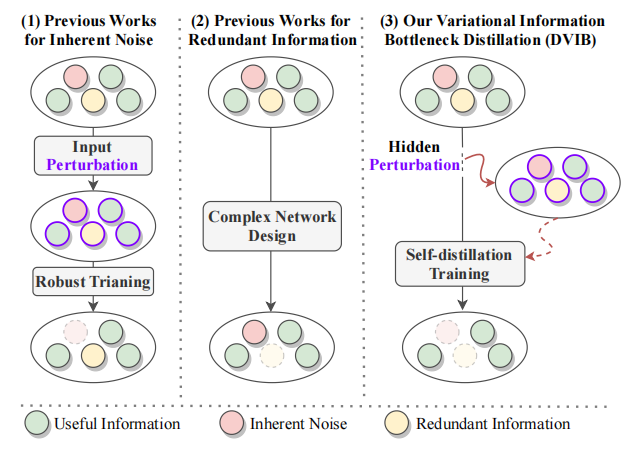
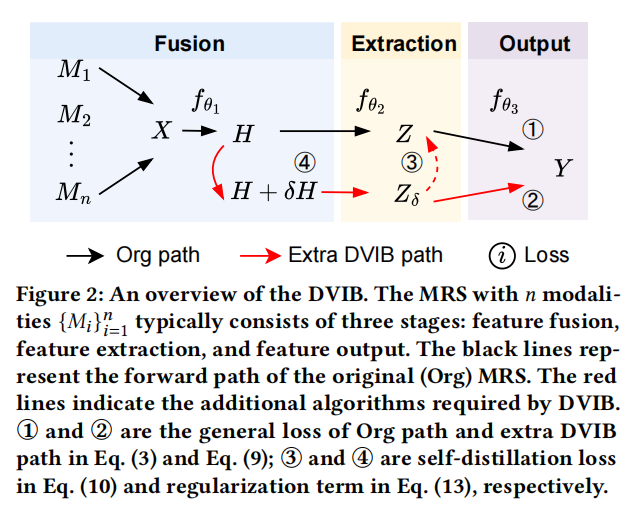

# DVIB: Towards Robust Multimodal Recommender Systems via Variational Information Bottleneck Distillation

**By Wenkuan Zhao (zhaowk5@mail2.sysu.edu.cn), Shanshan Zhong(zhongshsh5@mail2.sysu.edu.cn), Yifan Liu(liuyf278@mail2.sysu.edu.cn), Wushao Wen(wenwsh@mail.sysu.edu.cn), Jinghui Qin(scape1989@gmail.com), Mingfu Liang(mingfuliang2020@u.northwestern.edu), Zhongzhan Huang(huangzhzh23@mail2.sysu.edu.cn)**

This repository contains the implementation of the paper *"DVIB: Towards Robust Multimodal Recommender Systems via Variational Information Bottleneck Distillation"*. Our paper has been accepted at the **2025 ACM Web Conference (WWW2025)**.

## Introduction

Multimodal recommender systems (MRS) integrate various modalities to model user preferences and item characteristics more effectively. However, multimodal data introduces challenges from noise and information redundancy, affecting system robustness. 

Existing approaches address these issues separately through input-level perturbations or complex architectures separately. We propose the **DVIB framework**, which tackles both challenges simultaneously by shifting perturbations to hidden layers with feature self-distillation, enabling noise mitigation and redundancy handling without altering network architecture.



We provide theoretical evidence that DVIB enhances robustness and promotes an information bottleneck effect, reducing redundant information during multimodal fusion. Extensive experiments demonstrate consistent performance improvements across datasets and model settings. The framework of DVIB is shown as follows.



## Quick Start

### Environment Preparation
```bash
conda env create -f environment.yaml
conda activate dvib
pip install torch==2.0.1 torchvision==0.15.2 torchaudio==2.0.2 --index-url https://download.pytorch.org/whl/cu118
pip install --no-index torch_cluster -f https://pytorch-geometric.com/whl/torch-2.0.1+cu118.html
pip install --no-index torch-scatter -f https://pytorch-geometric.com/whl/torch-2.0.1+cu118.html
pip install --no-index torch_sparse -f https://pytorch-geometric.com/whl/torch-2.0.1+cu118.html
pip install --no-index torch_spline_conv -f https://pytorch-geometric.com/whl/torch-2.0.1+cu118.html
pip install torch_geometric
```

To run the code:

1. Navigate to the `src` directory:
   ```bash
   cd src
   ```

2. Execute the main script:
   ```bash
   python main.py
   ```

You can modify the model and dataset by using the following commands:

- To use the `BM3` model with the `baby` dataset:
   ```bash
   python main.py --model BM3 --dataset baby
   ```

- To use the `VBPR` model with the `sports` dataset:
   ```bash
   python main.py --model VBPR --dataset sports
   ```

## DVIB Framework Usage

Our DVIB framework offers two variants based on different perturbation strategies:

- DVIBc (*c.py): DVIB with constant perturbations.

- DVIBa (*a.py): DVIB with adaptive perturbations.

### Running DVIB Models

To run DVIB with different base models:

```bash 
python main.py --model VBPRc --dataset sports  # VBPR + DVIBc

python main.py --model VBPRa --dataset sports  # VBPR + DVIBa
```

## Supported Models and Datasets

### Models:
- VBPR
- MMGCN
- GRCN
- BM3
- FREEDOM

For more details on the models, please check `src/models`. 

### Datasets:
- Amazon datasets: You can download the preprocessed `baby`, `sports`, and `clothing` datasets from [**Google Drive**](https://drive.google.com/drive/folders/13cBy1EA_saTUuXxVllKgtfci2A09jyaG). The data already contains text and image features extracted from Sentence-Transformers and CNN.
- If you want to train models on other Amazon datasets, refer to the [**dataset processing tutorial**](https://github.com/enoche/MMRec/tree/master/preprocessing).

## Checkpoints

We also provide pre-trained checkpoints on Baby datasets:
- Location: `./checkpoints`

## Acknowledgments

We would like to express our gratitude to enoche for providing [**MMRec**](https://github.com/enoche/MMRec), which is used for multimodal recommendation tasks.


